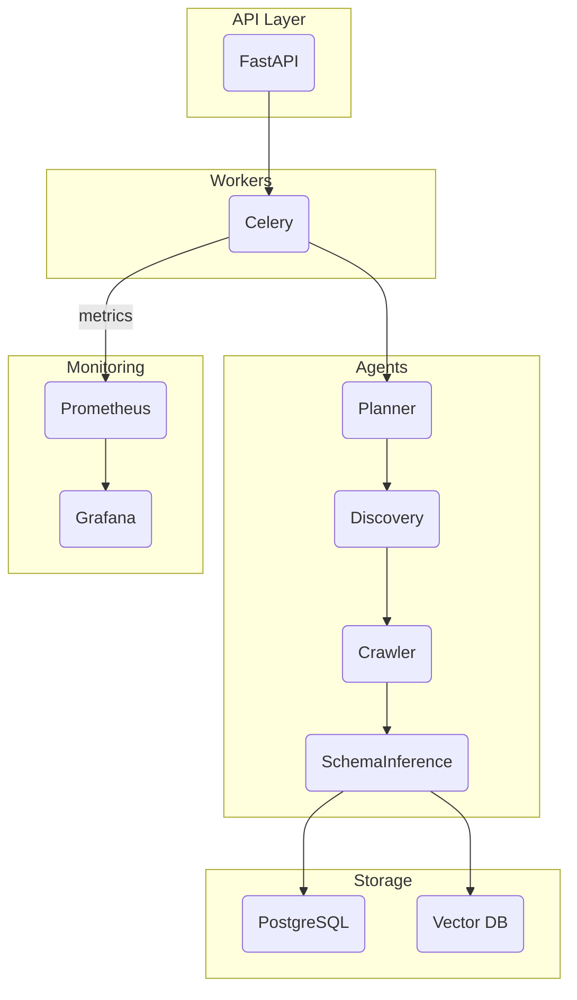

# Developer Guide

This guide describes the internal architecture, coding conventions and how to run WebSet Miner locally.

## Architecture Overview



### Layers

- **API Layer** – REST + WebSocket endpoints implemented with FastAPI. Handles authentication and dispatches tasks to Celery.
- **Agents** – Planner, Discovery, Browser Crawler and Schema Inference agents reside under `app/agents`. Each agent encapsulates a specific phase of a mining job.
- **Crawler** – Playwright based browser automation in `app/crawler` performs DOM extraction and screenshot capture.
- **Database** – SQLAlchemy models in `app/models` persist job metadata and results to PostgreSQL.
- **Celery Tasks** – Defined in `app/tasks`. The `mining_tasks` module orchestrates the agent pipeline. Background workers are started via `celery -A app.tasks.celery_app worker`.
- **Monitoring** – Prometheus metrics exposed by `/health/metrics` and dashboards defined under `monitoring/grafana`.

## Coding Conventions

- Python 3.11+ with type hints enforced by `mypy --strict`.
- Ruff for linting and formatting (`pre-commit run --all-files`).
- FastAPI routers live in `app/api/v1/`.
- Celery tasks use explicit names and should be idempotent.
- React/TypeScript frontend uses Vite and resides in `src/`.

## Running Locally

1. Create `.env` from `.env.example` (it omits `VAULT_TOKEN`) and set `DISABLE_VAULT_FOR_LOCAL_DEV=true`. Provide `VAULT_TOKEN` via an environment variable or Docker secret.
2. Start services:
   ```bash
   docker-compose up -d
   ```
3. Run the API with auto reload:
   ```bash
   uvicorn app.main:app --reload
   ```

### Environment Secrets

Secrets are pulled from Vault by default. During development they can be read from `.env` by setting `DISABLE_VAULT_FOR_LOCAL_DEV=true`. Use `fetch_vault_env.py` to generate a full `.env`.

### mTLS Toggle

Service to service communication can be secured with mutual TLS. Generate certificates using `scripts/generate_mtls_certs.sh` and set `MINIO_CLIENT_CERT`, `MINIO_CLIENT_KEY` and related variables. Omit these variables to disable mTLS locally.

## Debugging Tips

- Enable debug logging with `LOG_LEVEL=DEBUG`.
- Use `docker-compose logs <service>` to inspect service logs.
- Access the interactive docs at `http://localhost:8000/docs` once the API is running.

## Adding a New Phase or Agent

1. Create a class in `app/agents` inheriting from `BaseAgent`.
2. Implement the `execute()` method with your logic.
3. Register the agent in `app/tasks/mining_tasks.py` inside the job pipeline.
4. Add any new configuration options to `app/config.py` and document them in [CONFIGURATION.md](CONFIGURATION.md).
5. Write unit tests in `tests/unit/` for the new agent.

