# WebSets System Architecture Overview

## Executive Summary

WebSets is an enterprise-grade multi-tenant B2B SaaS platform designed for autonomous web data discovery and extraction. The system employs a microservices architecture with strict tenant isolation, comprehensive security controls, and enterprise-grade operational capabilities.

## Architecture Principles

### Design Philosophy
- **Security by Design**: Zero-trust architecture with defense in depth
- **Multi-tenancy First**: Tenant isolation at every layer of the stack
- **Cloud Native**: Kubernetes-native with 12-factor app principles
- **Observability**: Comprehensive monitoring, logging, and tracing
- **Compliance Ready**: SOC2, HIPAA, GDPR, and FedRAMP alignment

### Quality Attributes
- **Availability**: 99.9% uptime SLA with automated failover
- **Performance**: <500ms P95 latency, >1000 RPS throughput
- **Scalability**: Horizontal scaling with auto-scaling policies
- **Security**: Zero critical vulnerabilities, comprehensive audit trails
- **Maintainability**: Modular design with clear separation of concerns

## System Context

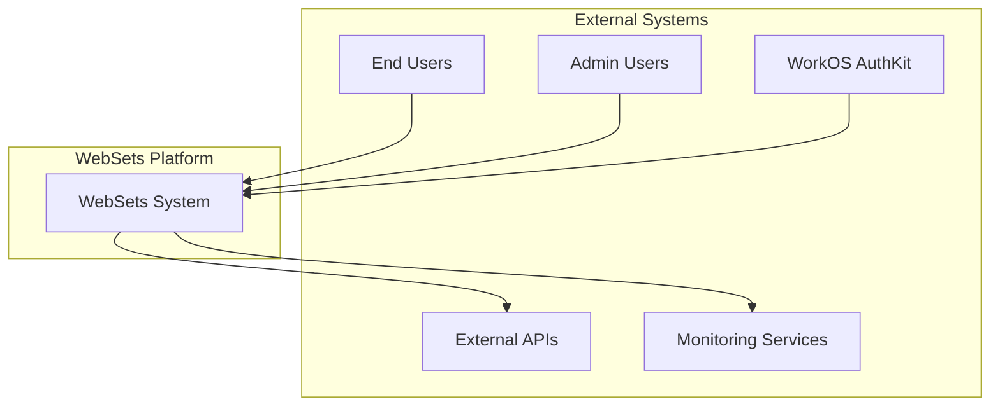

## High-Level Architecture

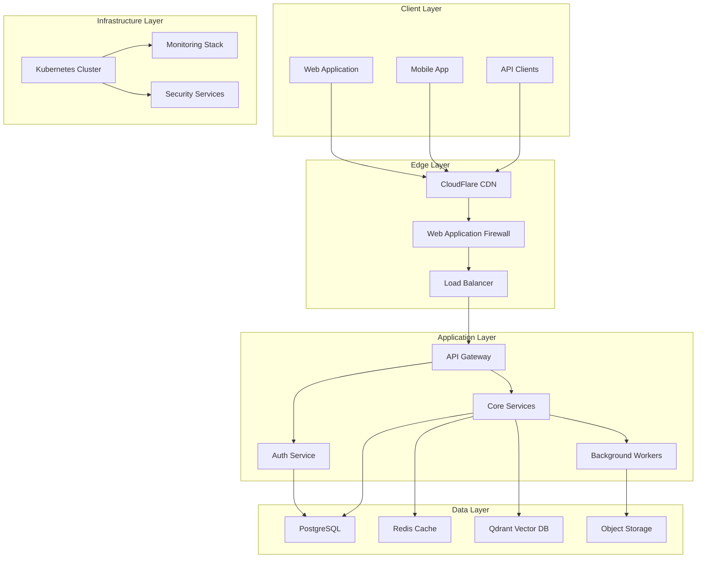

## Service Architecture

### Microservices Overview

| Service | Purpose | Technology | Scaling |
|---------|---------|------------|---------|
| **API Gateway** | Request routing, rate limiting, auth | FastAPI + Python | Horizontal |
| **Auth Service** | Authentication, authorization, RBAC | FastAPI + WorkOS | Horizontal |
| **Core Services** | Business logic, data processing | FastAPI + SQLAlchemy | Horizontal |
| **Worker Service** | Background jobs, data extraction | Celery + Python | Horizontal |
| **Web UI** | User interface, dashboard | React + TypeScript | CDN |

### Service Communication

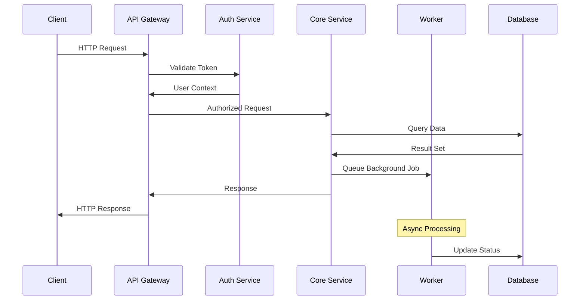

## Multi-Tenancy Architecture

### Tenant Isolation Model

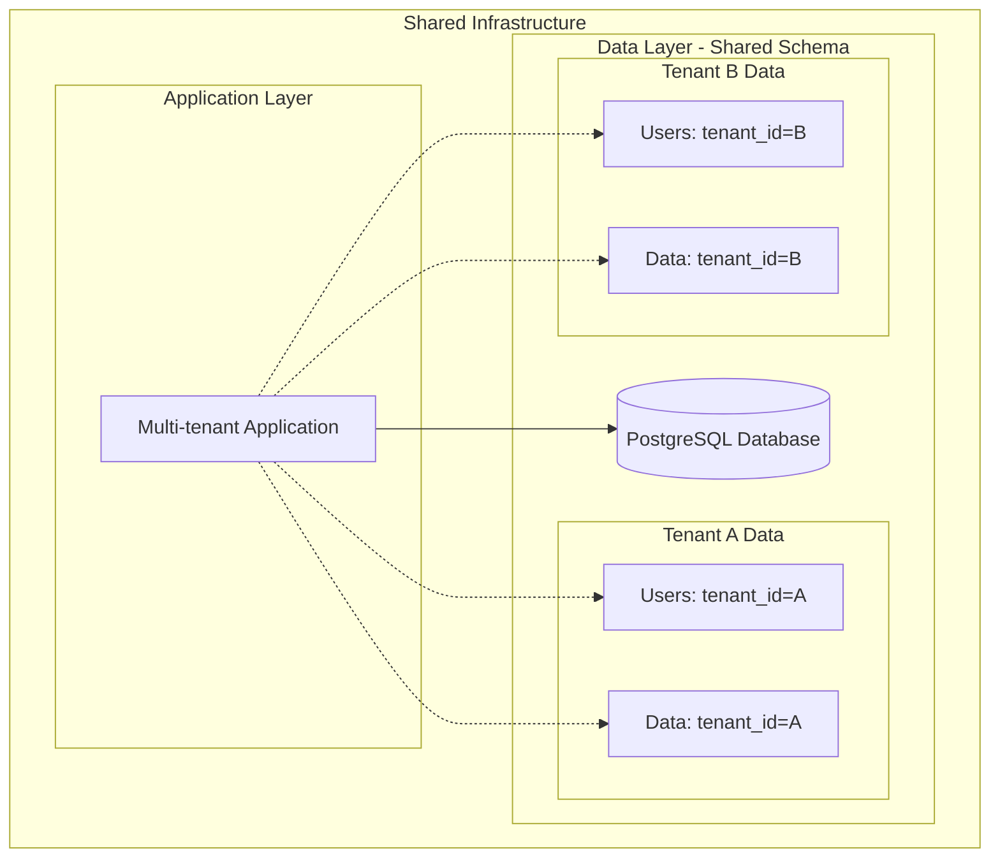

### Tenant Context Management

```python
# Tenant context enforcement at ORM level
@event.listens_for(Session, "do_orm_execute", propagate=True)
def _add_tenant_criteria(execute_state) -> None:
    tenant_id = _current_tenant.get()
    if tenant_id and execute_state.is_select:
        execute_state.statement = execute_state.statement.options(
            with_loader_criteria(
                cls, 
                lambda cls: cls.tenant_id == tenant_id, 
                include_aliases=True
            )
        )
```

### Security Boundaries

1. **Network Level**: VPC isolation, security groups
2. **Application Level**: Tenant context validation
3. **Data Level**: Row-level security with tenant_id
4. **API Level**: JWT claims validation
5. **UI Level**: Tenant-scoped data presentation

## Data Architecture

### Database Design

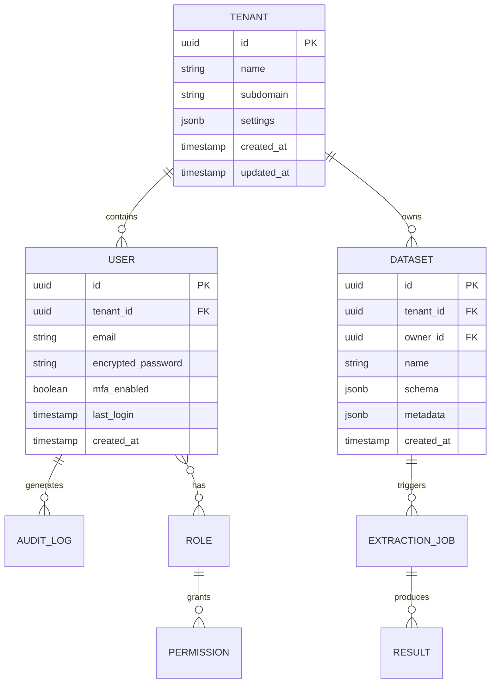

### Data Flow Architecture

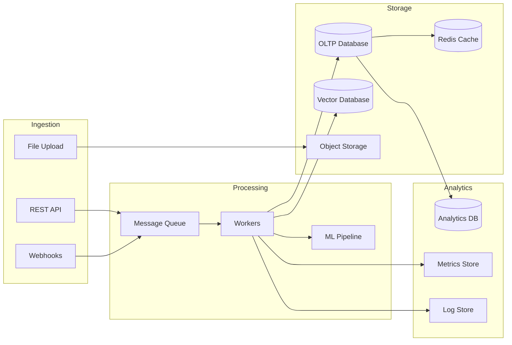

## Security Architecture

### Zero-Trust Security Model

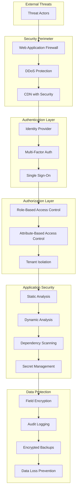

### Security Controls Matrix

| Layer | Control | Implementation | Compliance |
|-------|---------|----------------|------------|
| **Network** | TLS 1.3 | Ingress Controller | SOC2, FedRAMP |
| **Identity** | WorkOS AuthKit | JWT + MFA | SOC2, HIPAA |
| **Access** | RBAC + ABAC | Custom middleware | SOC2, GDPR |
| **Data** | Field encryption | AES-256-GCM | HIPAA, GDPR |
| **Audit** | Comprehensive logging | Structured logs | All standards |
| **Secrets** | Vault integration | Kubernetes secrets | SOC2, FedRAMP |

## Deployment Architecture

### Kubernetes Architecture

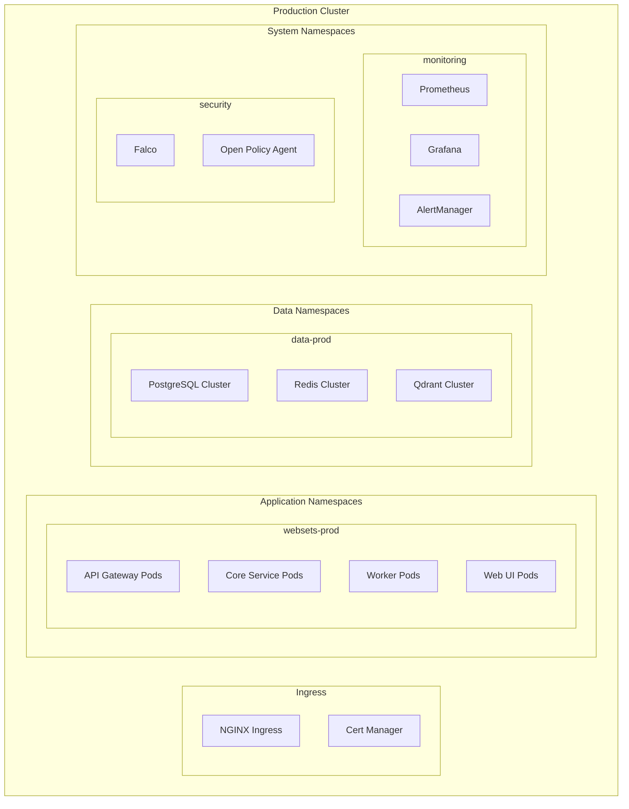

### Environment Strategy

| Environment | Purpose | Configuration | Deployment |
|-------------|---------|---------------|------------|
| **Development** | Feature development | Minimal resources | Auto-deploy on PR |
| **Staging** | Integration testing | Production-like | Auto-deploy on merge |
| **Production** | Live system | Full resources | Manual approval |

### Blue-Green Deployment

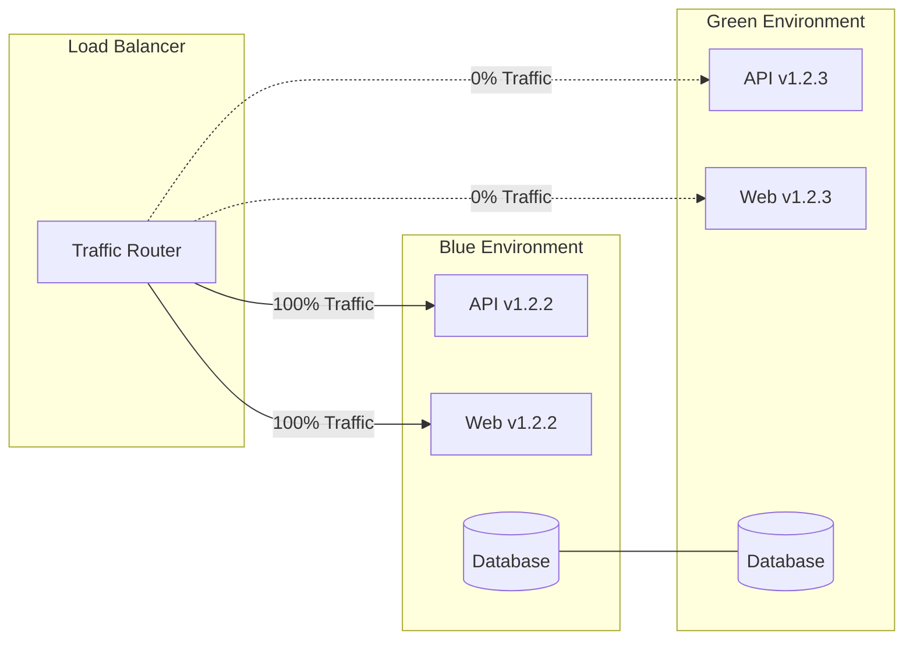

## Observability Architecture

### Monitoring Stack

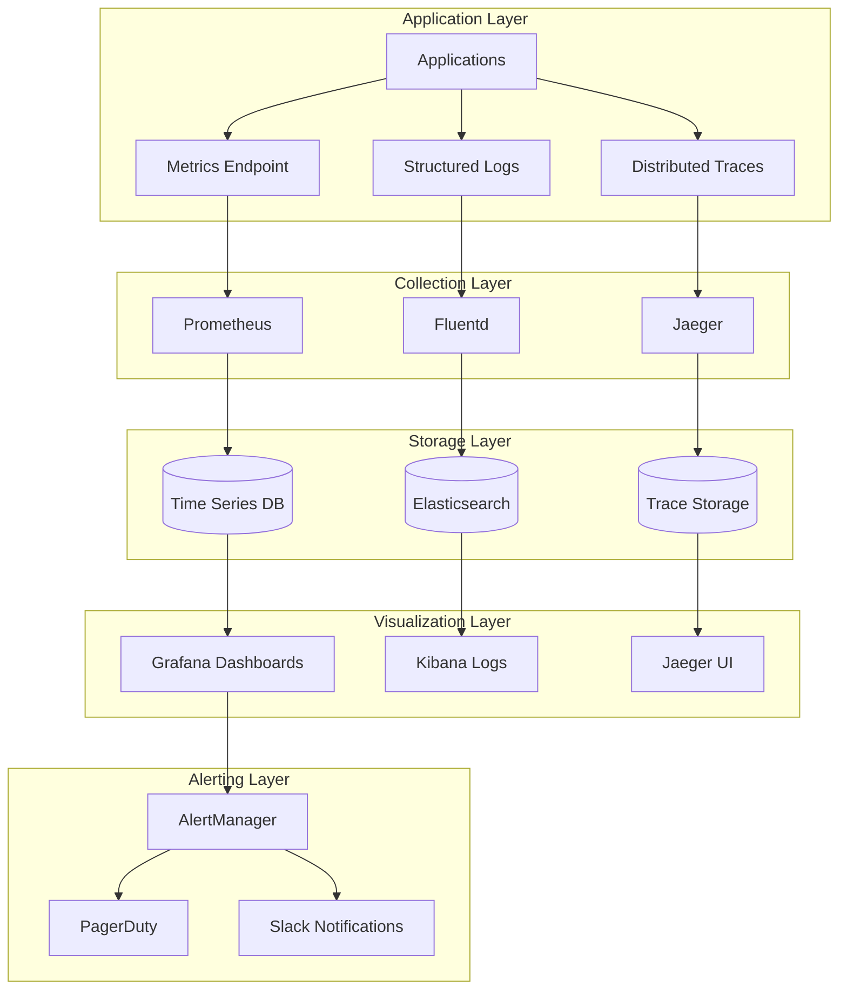

### Key Metrics & SLIs

| Category | Metric | Target | Alert Threshold |
|----------|--------|--------|-----------------|
| **Availability** | Uptime | 99.9% | <99.5% |
| **Performance** | P95 Latency | <500ms | >1000ms |
| **Throughput** | Requests/sec | >1000 | <500 |
| **Errors** | Error Rate | <0.1% | >1% |
| **Security** | Failed Auth | <1% | >5% |

## Compliance & Governance

### Compliance Framework

```mermaid
graph TB
    subgraph "Compliance Standards"
        SOC2[SOC2 Type II]
        HIPAA[HIPAA]
        GDPR[GDPR]
        FEDRAMP[FedRAMP]
    end
    
    subgraph "Technical Controls"
        ENCRYPT[Data Encryption]
        ACCESS[Access Controls]
        AUDIT[Audit Logging]
        BACKUP[Secure Backups]
    end
    
    subgraph "Operational Controls"
        POLICY[Security Policies]
        TRAINING[Staff Training]
        INCIDENT[Incident Response]
        REVIEW[Regular Reviews]
    end
    
    subgraph "Monitoring Controls"
        SCAN[Vulnerability Scanning]
        MONITOR[Continuous Monitoring]
        REPORT[Compliance Reporting]
        ASSESS[Risk Assessment]
    end
    
    SOC2 --> ENCRYPT
    SOC2 --> ACCESS
    SOC2 --> AUDIT
    
    HIPAA --> ENCRYPT
    HIPAA --> ACCESS
    HIPAA --> BACKUP
    
    GDPR --> AUDIT
    GDPR --> ACCESS
    GDPR --> POLICY
    
    FEDRAMP --> ENCRYPT
    FEDRAMP --> MONITOR
    FEDRAMP --> SCAN
```

### Data Governance

1. **Data Classification**: Public, Internal, Confidential, Restricted
2. **Data Retention**: Automated lifecycle management
3. **Data Portability**: GDPR-compliant export capabilities
4. **Data Deletion**: Right to erasure implementation
5. **Data Lineage**: Complete audit trail tracking

## Disaster Recovery

### Recovery Strategy

| Component | RTO | RPO | Strategy |
|-----------|-----|-----|----------|
| **Application** | 15 min | 5 min | Blue-green deployment |
| **Database** | 30 min | 1 min | Streaming replication |
| **File Storage** | 1 hour | 15 min | Cross-region replication |
| **Full System** | 4 hours | 1 hour | Multi-region failover |

### Backup Architecture

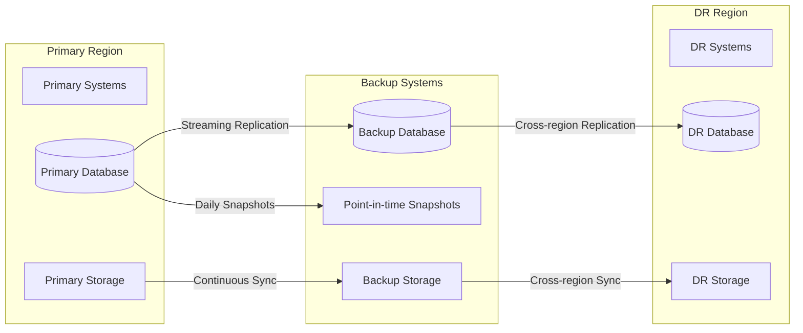

## Performance & Scalability

### Scaling Strategy

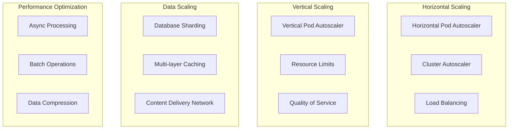

### Caching Strategy

1. **L1 Cache**: Application-level caching (Redis)
2. **L2 Cache**: Database query result caching
3. **L3 Cache**: CDN edge caching for static assets
4. **L4 Cache**: Browser caching with appropriate headers

## Technology Stack Summary

### Backend Technologies
- **Runtime**: Python 3.11+ with FastAPI framework
- **Database**: PostgreSQL 15+ with read replicas
- **Cache**: Redis 7+ with clustering
- **Vector DB**: Qdrant for ML/AI workloads
- **Message Queue**: Celery with Redis broker
- **Authentication**: WorkOS AuthKit integration

### Frontend Technologies
- **Framework**: React 18.3.1 with TypeScript
- **Build Tool**: Vite with hot module replacement
- **Styling**: Tailwind CSS with shadcn/ui components
- **State Management**: React Query + Context API
- **Testing**: Jest + React Testing Library

### Infrastructure Technologies
- **Container**: Docker with multi-stage builds
- **Orchestration**: Kubernetes 1.28+
- **Service Mesh**: Istio (optional)
- **Ingress**: NGINX Ingress Controller
- **Monitoring**: Prometheus + Grafana + AlertManager
- **Logging**: Fluentd + Elasticsearch + Kibana

### Security Technologies
- **SAST**: Semgrep, Bandit, ESLint security rules
- **DAST**: OWASP ZAP automated scanning
- **Container Security**: Trivy, Hadolint
- **Secret Management**: Kubernetes secrets + Vault
- **Compliance**: Automated compliance checking

---

**Document Version**: 1.0  
**Last Updated**: 2024-01-15  
**Next Review**: 2024-04-15  
**Owner**: Platform Architecture Team
